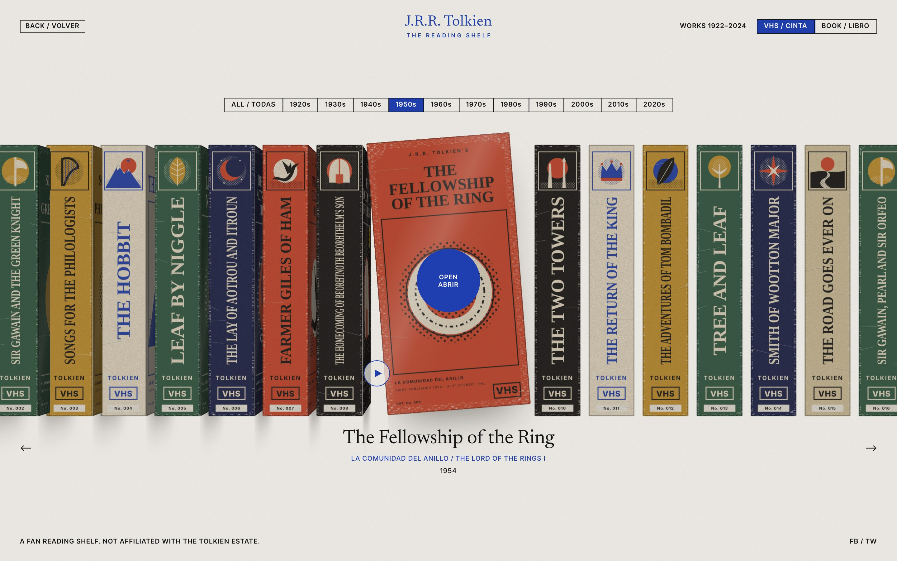
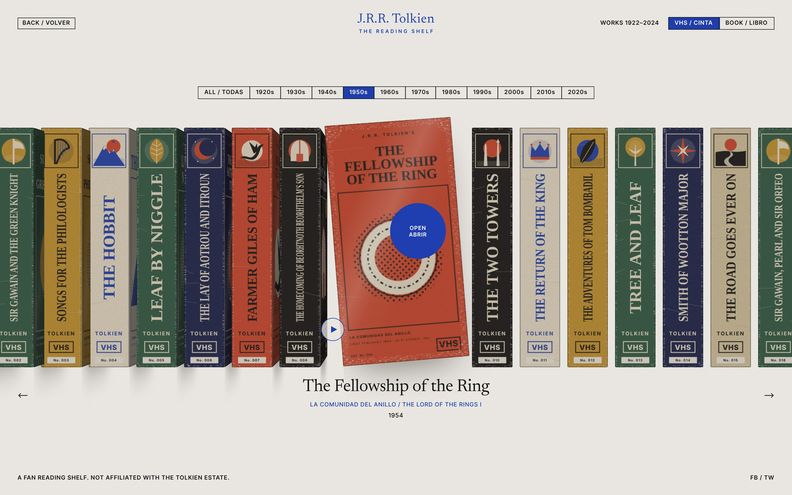
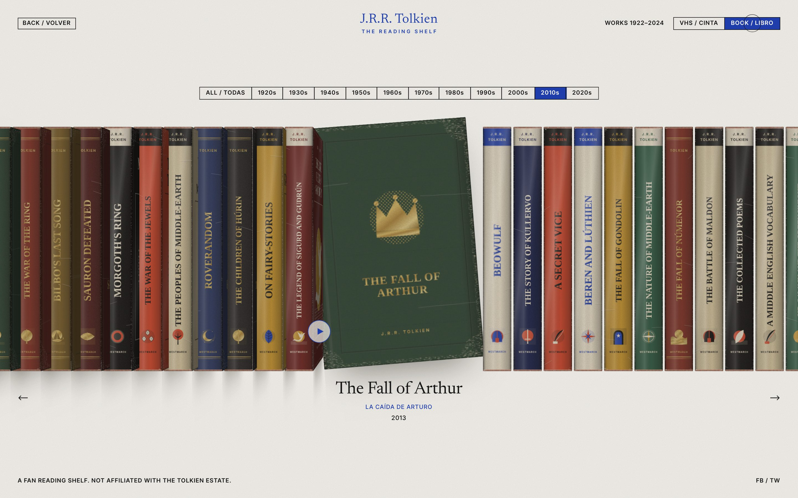
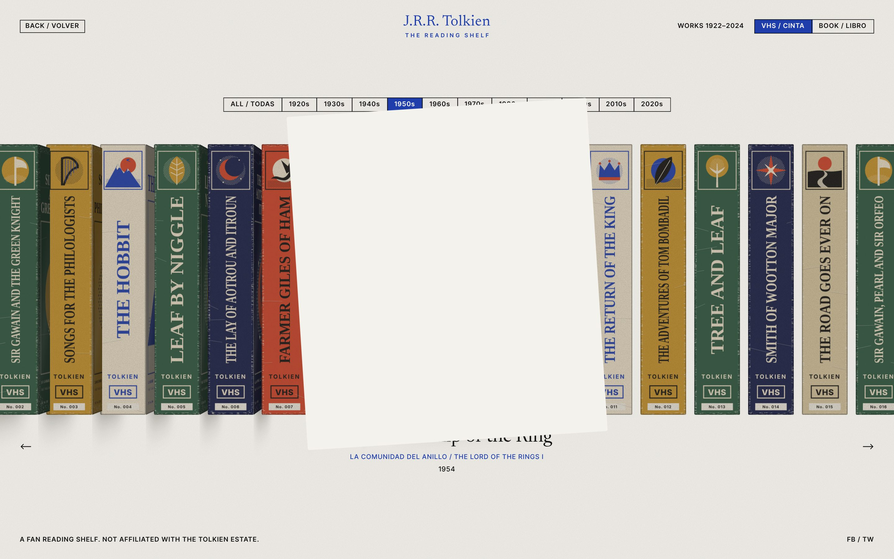
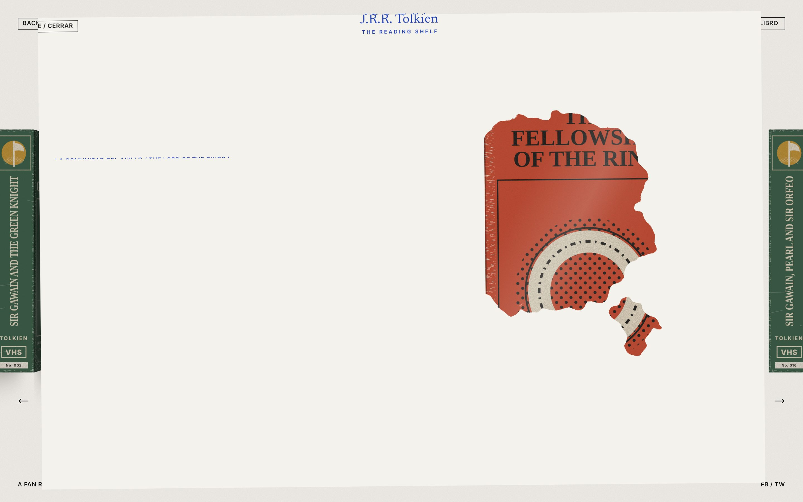
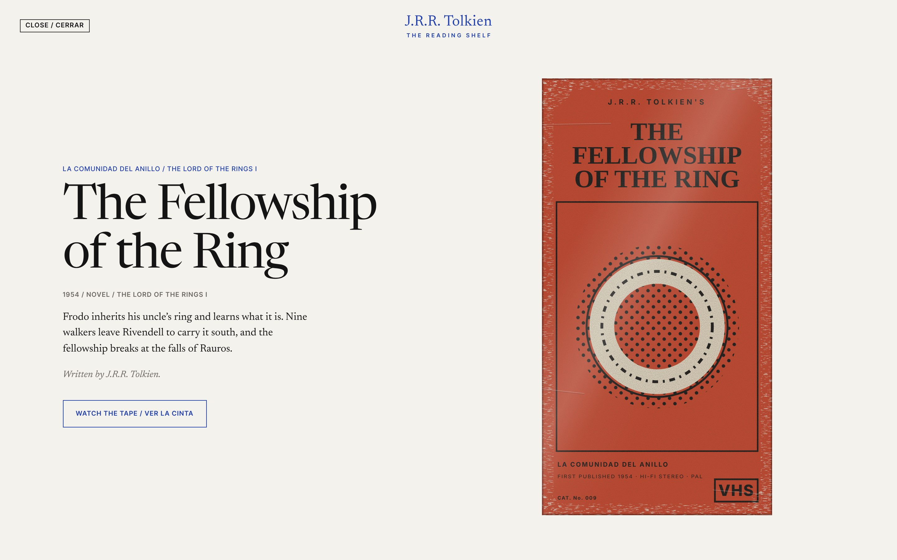
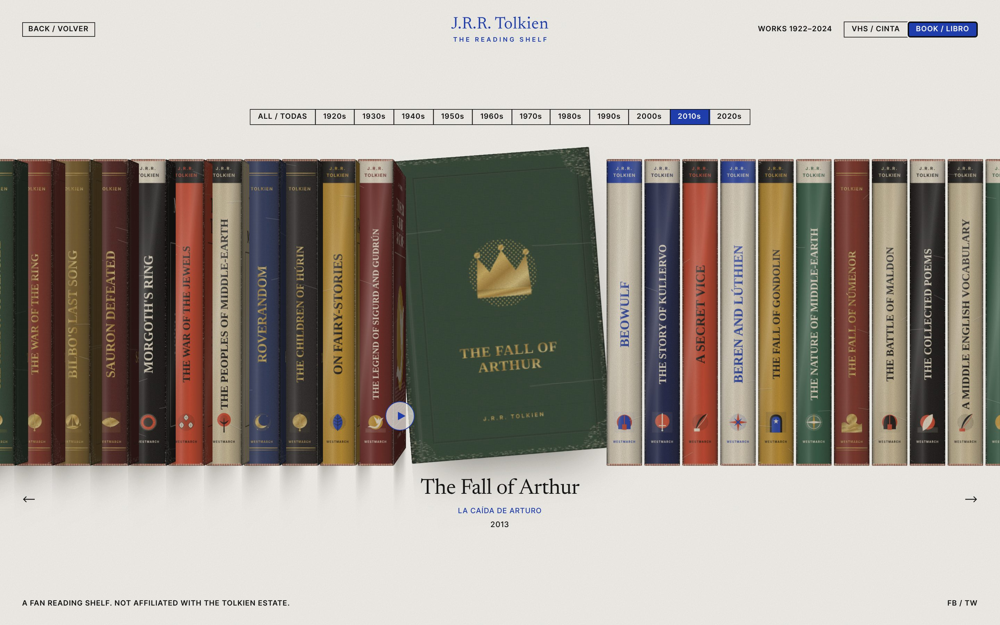
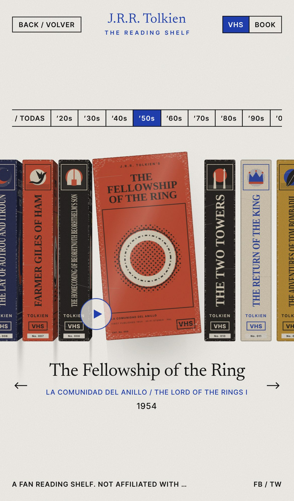
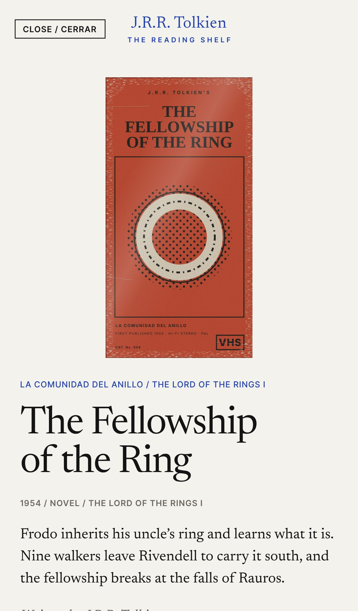

<div align="center">

# J.R.R. Tolkien · The Reading Shelf

**An endless 3D shelf of every J.R.R. Tolkien work, as worn rental VHS tapes or gilt hardbacks.**




</div>

---

## What it is

A long shelf runs across a sheet of warm paper, holding **51 works by Tolkien**, from *A Middle English Vocabulary* (1922) to *The Collected Poems* (2024). The active work is pulled out and **turned in 3D** to show its cover. It sits tilted a few degrees, lifted slightly, and casts a shadow on the paper.

You can move along the shelf by clicking a spine, using the arrows or a decade tab, scrolling, dragging or pressing the keyboard arrows. When you open a work, **a sheet of paper grows out of the cover** to fill the screen, and the poster appears in **spreading blots of ink**.

> Nothing ever fades in or out: every reveal is a mask, a clip or a scale.

## Two formats, one shelf

| Rental VHS | Hardback |
|:---:|:---:|
|  |  |
| Cardboard sleeves with rubbed edges, creases, a plastic sheen, catalogue numbers and a *Bree Video* rental sticker. | Gilt cloth or printed dust jackets, with rounded spines, headbands, hinges and bumped corners. |

The **VHS / Book** switch tweens the proportions of the 3D box live: the spines get narrower and the covers wider, with no jump.

## Opening a work

| 1. The sheet grows out of the cover | 2. The poster bleeds in |
|:---:|:---:|
|  |  |

| 3. Detail, VHS | 3. Detail, book |
|:---:|:---:|
|  |  |

The sheet starts as the cover's clipped, tilted rectangle and straightens out to full screen. Each line of text rises out of its own mask. The poster shows through seven circles whose edges are roughened with `feTurbulence` and `feDisplacementMap`.

## On mobile

<p align="center">
  
  &nbsp;&nbsp;
  
</p>

All the geometry scales from a single CSS variable, `--H`. You can drag the shelf with a finger, the decade tabs scroll sideways, and the detail page becomes a single scrolling column.

## Details

- **Custom cursor:** a ring that shrinks over spines. Over the cover it becomes a cobalt "OPEN" disc, and the cover leans towards it.
- **Spring physics:** a jump of several works glides through every work in between, and each one half-opens as it passes. The caption shows every title in turn through its mask.
- **Decade tabs:** a cobalt block slides and stretches to the decade of the active work.
- **Paper grain:** a noise layer blended with `multiply` covers the whole page, tapes included.
- **Accessibility:** controls are real buttons, the caption uses `aria-live`, the detail is a modal dialog, and with `prefers-reduced-motion` every movement happens instantly.

## Run it locally

```bash
git clone https://github.com/utity-tools/tolkien-library.git
cd tolkien-library
npm install
npm run dev     # → http://localhost:5173
```

| Command | What it does |
|---|---|
| `npm run dev` | Dev server with hot reload |
| `npm run build` | Type-checks, then builds for production into `dist/` |
| `npm run preview` | Serves the production build |
| `npm run typecheck` | Runs TypeScript only |

You need Node 18 or later.

### Controls

| Input | Action |
|---|---|
| Click a spine | Glides the shelf to that work |
| Click the cover · <kbd>Enter</kbd> · ▶ | Opens the detail page |
| <kbd>←</kbd> <kbd>→</kbd> · on-screen arrows | Previous / next work |
| Wheel · drag | Scrubs the shelf, then settles on the nearest work |
| Decade tabs | Jumps to the decade's first work by the shortest way round |
| <kbd>Esc</kbd> · Close | Folds the sheet back into the cover |

## How it's built

```
src/
├─ engine/ShelfEngine.ts   one rAF loop: spring, turning, tilt, cursor, every input
├─ data/works.ts           all 51 works (EN/ES titles, year, genre, editor, synopsis)
├─ data/sheets.ts          optional real artwork sheets + crop boxes
├─ art/                    generated SVG art: vhs.ts, book.ts, motifs.ts, wear.ts
├─ lib/                    formats, math, motion curves
├─ hooks/                  useShelfEngine, useMaskSwap, useLatest
└─ components/             TopBar, Segmented, Shelf, Caption, DetailSheet, InkPoster…
```

**Performance:** React renders the structure once. A single `requestAnimationFrame` loop moves every tape by writing `transform` straight to the DOM, so React never re-renders per frame. Tapes that are off-screen are hidden and never painted. The SVG art is generated once per face and format, then cached as a data URL.

**Shelf math:** a tape at relative index `r` sits at `x = r·(ws+gap) + (d−ws+1.6·gap)·B(r)`. `B` is a smooth, continuous step, so the open cover pushes its neighbours apart without any jump. Openness is `smoothstep(1−|r|)`, and the rotation, lift, push towards the viewer and shading are all derived from it.

## Bring your own artwork

The generated art is only a fallback. To use real images, declare a sheet and its crop boxes in `src/data/sheets.ts`:

```ts
export const SHEET = {
  covers: ['https://…/covers.webp', 1744, 2336],
};

export const CROP = {
  'vhs-cover-hobbit': ['covers', 497, 72, 344, 659],
  'book-spine-silmarillion': ['spines', 266, 31, 189, 1089],
};
```

Keys follow the pattern `<vhs|book>-<spine|cover>-<workId>`. Each crop is stretched exactly over its face, and the detail poster uses the same crop. Any face without a `CROP` entry keeps its generated art.

---

<div align="center">
<sub>A fan project, not affiliated with the Tolkien Estate. All artwork is original and generated in code.</sub>
</div>
